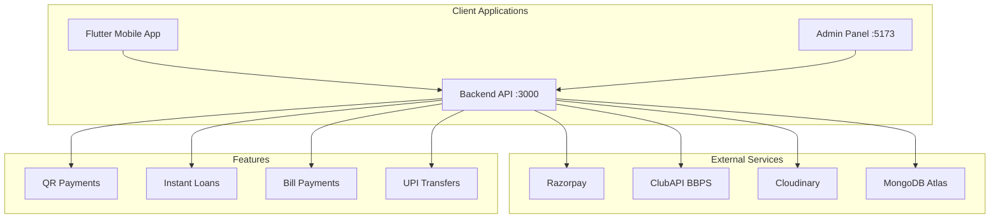

# 🚀 **Khatu Pay** - Complete Project Report & Blueprint

<div align="center">
  
  
  <h1>Comprehensive Project Documentation</h1>
</div>

---

## 📋 Executive Summary

**Khatu Pay** is a comprehensive fintech platform providing digital payments, instant loans, and bill payment services across India. The platform consists of three integrated components:

- **Backend API**: Node.js/Express REST API with MongoDB
- **Admin Panel**: React + Vite management dashboard
- **Mobile App**: Flutter cross-platform application

---

## 🏗️ Project Architecture

### System Overview



---

## 📁 Project Structure

```
Khatu Pay/
├── admin_panel/           # React Admin Panel (Port 5173)
│   ├── src/
│   │   ├── components/  # Reusable UI components
│   │   ├── pages/       # 70+ admin pages
│   │   ├── api/         # API client
│   │   └── utils/       # Utilities
│   ├── dist/            # Production build
│   └── package.json
│
├── backend/             # Node.js Backend API (Port 3000)
│   ├── src/
│   │   ├── routes/     # 50+ route modules
│   │   ├── models/     # Mongoose models (25+)
│   │   ├── services/   # Business logic
│   │   ├── middlewares/# Auth, error handling
│   │   └── utils/      # Helpers
│   └── package.json
│
├── khatupay_app/       # Flutter Mobile App
│   ├── lib/
│   │   ├── core/      # App configuration
│   │   ├── models/    # Data models
│   │   ├── providers/ # Riverpod state
│   │   ├── services/  # API services
│   │   ├── routes/    # Navigation
│   │   └── ui/       # Screens/widgets
│   └── pubspec.yaml
│
└── uploads/            # File uploads directory
```

---

## 💻 Technology Stack

### Backend
| Technology | Purpose |
|------------|---------|
| Node.js 18+ | Runtime |
| Express.js | Web Framework |
| MongoDB + Mongoose | Database |
| JWT | Authentication |
| bcrypt | Password Hashing |
| Razorpay | Payment Gateway |
| ClubAPI | Bill Payments (BBPS) |
| Cloudinary | File Storage |
| NodeMailer | Email Service |
| FCM | Push Notifications |
| Helmet | Security |
| QRCode | QR Generation |

### Admin Panel
| Technology | Purpose |
|------------|---------|
| React 18 | UI Framework |
| Vite | Build Tool |
| Bootstrap 5 | CSS Framework |
| React Router | Navigation |
| Axios | HTTP Client |
| Chart.js | Charts |
| DataTables | Tables |

### Mobile App
| Technology | Purpose |
|------------|---------|
| Flutter 3.3+ | Framework |
| Dart | Language |
| Riverpod 2.5 | State Management |
| Dio 5.7 | API Client |
| razorpay_flutter | UPI Payments |
| qr_flutter | QR Codes |
| mobile_scanner | QR Scanning |
| firebase_messaging | Push |
| local_auth | Biometrics |
| pdf + printing | Invoices |

---

## 🔌 Core Features

### 1. Payment Services

#### QR Payments (Merchant)
- Generate QR codes for merchants
- Scan and pay via UPI
- Transaction tracking
- Settlement management

#### UPI Payments
- Virtual account creation
- P2P transfers
- Payment links
- Razorpay integration

### 2. Bill Payments (ClubAPI)

| Service | Operators |
|---------|------------|
| Mobile Recharge | All Indian operators |
| DTH | Tata Play, Dish TV, Sun Direct |
| Electricity | State discoms |
| Water | Municipal boards |
| Gas | PNG, LPG |
| Internet | ACT, BSNL, JioFiber |
| FASTag | HDFC, ICICI, Axis |

### 3. Instant Loans

- Loan application processing
- EMI calculation
- Loan disbursement
- Repayment tracking
- Penalty management
- Settlement options

### 4. User Management

- KYC verification
- Agent network
- Employee management
- Family accounts
- Audit logging

---

## 🔗 API Endpoints Summary

### Authentication
```
POST   /api/auth/register
POST   /api/auth/login
POST   /api/auth/otp/verify
POST   /api/auth/refresh
```

### Users
```
GET    /api/users
GET    /api/users/:id
PUT    /api/users/:id
DELETE /api/users/:id
POST   /api/users/kyc
```

### Loans
```
POST   /api/loans/apply
GET    /api/loans
GET    /api/loans/:id
PUT    /api/loans/:id
POST   /api/loans/:id/repay
```

### Payments
```
POST   /api/payments/create
POST   /api/payments/verify
GET    /api/payments
POST   /api/payments/link
```

### QR Codes
```
POST   /api/qr/generate
GET    /api/qr/:id
GET    /api/qr/transactions
```

### Bill Payments
```
POST   /api/clubapi/recharge
POST   /api/clubapi/bill/fetch
POST   /api/clubapi/bill/pay
GET    /api/clubapi/transactions
```

### Admin
```
GET    /api/admin/dashboard
GET    /api/admin/users
GET    /api/admin/loans
GET    /api/admin/earnings
POST   /api/admin/payout
GET    /api/admin/reports
POST   /api/admin/invoice
```

---

## 📊 Database Models

### Core Models

1. **User** - Customer accounts
2. **UserKYC** - Identity verification
3. **Employee** - Staff accounts
4. **Agent** - Distribution partners
5. **Transaction** - All financial transactions
6. **Payment** - Payment records
7. **Loan** - Loan applications
8. **EMI** - Repayment schedules
9. **QRCode** - Merchant QR codes
10. **Invoice** - Billing documents
11. **Payout** - Agent/Employee payouts
12. **WithdrawalRequest** - Settlement requests
13. **Collection** - EMI collections
14. **SupportTicket** - Customer support
15. **Notification** - App notifications
16. **AuditLog** - System audit trail

---

## 🔐 Security Implementation

### Authentication
- JWT tokens with refresh mechanism
- bcrypt password hashing
- Role-based access control
- Biometric authentication (mobile)

### API Security
- Helmet.js headers
- CORS configuration
- Rate limiting
- Input validation
- Fraud detection

### Data Security
- Encryption at rest
- Secure file uploads
- Audit logging
- KYC data protection

---

## 📈 Admin Panel Features

### Dashboard Pages
- Main Dashboard
- Earnings Dashboard
- Loan Dashboard
- QR Dashboard
- ClubAPI Dashboard
- Employee Dashboard

### Management Pages
- Users Management
- Employee Management
- Agent Management
- Loan Management
- Payment Management
- Invoice Management
- Payout Management
- Withdrawal Management

### Reports
- Transaction Reports
- Earnings Reports
- Agent Performance
- Loan Tracking
- Audit Logs

### Settings
- App Settings
- ClubAPI Configuration
- Notification Settings

---

## 📱 Mobile App Features

### Core Features
- QR Code Generation
- QR Scanner & Payment
- UPI Payments
- Mobile Recharge
- DTH Recharge
- Bill Payments
- Loan Application
- EMI Tracking

### Account
- Registration/Login
- Profile Management
- KYC Upload
- Transaction History
- Biometric Login

### Support
- Help Center
- Customer Support
- Notifications

---

## 🚀 Getting Started

### Prerequisites
```bash
# Backend
Node.js 18+
MongoDB Atlas account

# Admin Panel
Node.js 18+
npm or yarn

# Mobile App
Flutter SDK 3.3+
Android Studio / Xcode
```

### Environment Setup

#### Backend (.env)
```env
MONGO_URI=mongodb+srv://...
JWT_ACCESS_SECRET=your_secret
JWT_REFRESH_SECRET=your_refresh
RAZORPAY_KEY_ID=rzp_test_...
RAZORPAY_KEY_SECRET=...
CLUBAPI_TOKEN=...
CLOUDINARY_CLOUD_NAME=...
CLOUDINARY_API_KEY=...
CLOUDINARY_API_SECRET=...
MAIL_HOST=smtp.gmail.com
MAIL_USER=your_email
MAIL_PASS=your_password
FCM_KEY=...
```

#### Admin Panel
```bash
cd admin_panel
npm install
npm run dev  # http://localhost:5173
```

#### Backend
```bash
cd backend
npm install
npm run dev  # http://localhost:3000
```

#### Mobile App
```bash
cd khatupay_app
flutter clean
flutter pub get
flutter run
```

---

## 📋 Company Information

| Field | Details |
|-------|---------|
| Business Name | Khatu Pay |
| GST Number | 09AAMCK7213N1ZY |
| Registered Address | India |
| Support Email | support@khatupay.com |

---

## 🔄 Integration Partners

### Payment Gateway
- **Razorpay**
  - UPI Payments
  - Payment Links
  - Virtual Accounts
  - EMI Payments

### Bill Payments
- **ClubAPI (BBPS)**
  - Mobile Recharge
  - DTH Recharge
  - Electricity Bills
  - Water Bills
  - Gas Bills
  - Internet Bills
  - FASTag

### Cloud Services
- **MongoDB Atlas** - Database
- **Cloudinary** - File Storage
- **Firebase** - Push Notifications

---

## 📝 Compliance & Legal

### Required Pages
- Privacy Policy
- Terms & Conditions
- Refund Policy
- Cookie Policy
- Disclaimer
- Security Policy

### Razorpay Compliance
- Business description display
- Service descriptions
- Company details
- GST verification
- Refund/cancellation policy

---

## 🛠️ Development Workflow

### Code Structure

#### Backend Routes
```
routes/
├── auth.js          # Authentication
├── users.js        # User management
├── loans.js        # Loan processing
├── payments.js     # Payment processing
├── qr.js           # QR code routes
├── bills.js        # Bill payments
├── recharge.js    # Mobile/DTH
├── admin/          # Admin routes (25+)
└── clubapi/       # ClubAPI integration
```

#### Admin Pages
```
pages/
├── Dashboard.jsx
├── Users.jsx
├── Loans.jsx
├── Payments.jsx
├── QR.jsx
├── Reports.jsx
└── Settings.jsx
```

---

## 📊 Performance Metrics

### Expected Load
- 10,000+ concurrent users
- 1000+ transactions/day
- 100+ loan applications/day

### Optimization
- MongoDB indexing
- API caching
- Lazy loading (React)
- Image compression

---

## 🔧 Maintenance

### Regular Tasks
- Database backups
- Security updates
- Feature updates
- Bug fixes
- Performance monitoring

### Monitoring
- Error tracking
- Transaction monitoring
- User activity
- Revenue tracking

---

## 📅 Version History

| Version | Date | Changes |
|---------|------|---------|
| 1.0 | Initial | Basic features |
| 2.0 | Current | Full fintech platform |

---

## 🤝 Support & Contact

- **Email**: support@khatupay.com
- **Phone**: Available on website
- **Address**: Listed in Contact page

---

## 📄 License

MIT License

---

<div align="center">
  <strong>Built with ❤️ by Team Khatu Pay</strong> |
  <a href="#">Website</a> |
  <a href="#">Support</a>
</div>
