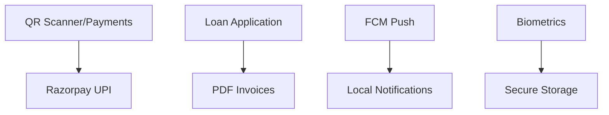

# 🚀 **Khatu Pay** - Flutter Mobile App

[](https://flutter.dev)
[](https://dart.dev)
[](https://riverpod.dev)
[](../LICENSE)

<div align=\"center\">
  
  <h1>Modern Fintech App with Dark Theme ✨</h1>
  
</div>

## 📱 **Overview**
**Khatu Pay Mobile App** - Production-ready Flutter app featuring:
- **QR Payments** (Scan, Generate, UPI)
- **Instant Loans** & EMI Tracking
- **Bill Recharges** via ClubAPI
- **Secure Biometrics** & Session Protection
- **Real-time Push Notifications**

## ✨ **Core Features**


- ✅ **QR**: Generate, Scan, Pay
- ✅ **Payments**: Razorpay integration
- ✅ **Auth**: Biometrics + PIN
- ✅ **Docs**: PDF generation/print
- ✅ **Network**: Offline handling
- ✅ **Theme**: Material 3 Dark (Green/Teal)

## 🛠️ **Tech Stack**
| Tech | Purpose |
|------|---------|
| **Riverpod 2.5** | State Management |
| **Dio 5.7** | API Client |
| **razorpay_flutter** | UPI/Payments |
| **qr_flutter + mobile_scanner** | QR Codes |
| **firebase_messaging** | Push Notifications |
| **local_auth** | Biometrics |
| **pdf + printing** | Invoices |

## 🚀 **Getting Started**

### Prerequisites
```bash
Flutter SDK >= 3.3.0
Android Studio / Xcode
```

### Run Development
```bash
cd khatupay_app
flutter clean
flutter pub get
flutter run
```

### Build Release
```bash
# APK
flutter build apk --release

# App Bundle
flutter build appbundle

# iOS
flutter build ios --release
```

## 🎨 **Custom Theme**
```dart
// Dark Material 3 (from main.dart)
primary: Color(0xFF20C997), // Green
background: Color(0xFF0A1929), // Dark
```


## 🔗 **API Integration**
```
Backend: http://localhost:3000/api
Admin: http://localhost:5173
```

## 📁 **Code Structure**
```
lib/
├─ main.dart          # Entry + Theme
├─ core/              # FCM, Timeout
├─ routes/app_router.dart
├─ providers/         # State
├─ services/          # Dio API
├─ models/            # Data Classes
└─ ui/               # Screens
```

## 🧪 **Testing & Lint**
```bash
flutter analyze
flutter test
flutter format .
```

## 🤝 **Contributing**
1. Fork → Clone → `flutter pub get`
2. Create feature branch
3. PR with tests ✅

## 📄 **License**
MIT License - See [LICENSE](../LICENSE)

---

<div align=\"center\">
  <strong>Built with ❤️ using Flutter</strong> | 
  [<kbd>Backend</kbd>](../backend/) | 
  [<kbd>Admin</kbd>](../admin_panel/)
</div>


